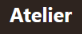

--  --

# ATELIER - Landing page 

Questa repository contiene il codice sorgente di una landing page sviluppata per **Atelier**, uno studio di architettura. La piattaforma è progettata per presentare lo studio, i servizi offerti e permettere agli utenti di mettersi in contatto per nuovi progetti.

---

> **Stato del progetto:** ultimato e in attesa di aggiornamenti. Questo file viene aggiornato a mano a mano che il progetto viene realizzato.

## Indice

- [Funzionalità](#funzionalità)
- [Tecnologie Utilizzate](#tecnologie-utilizzate)
- [Come Eseguire il Progetto Locale](#come-eseguire-il-progetto-locale)
- [Struttura del progetto](#struttura-del-progetto)
- [Architettura, Responsive Design e Media Query](#architettura-responsive-design-e-media-query)
- [Albero del dom](#albero-del-dom)
- [Validazione dei Campi del Form](#validazione-dei-campi-del-form)
- [Come funziona](#come-funzionamente)
- [Convenzioni di codice](#convenzioni-di-codice)
- [Aggiornamenti](#aggiornamenti)
- [Realizzato da](#realizzato-da)

### Funzionalità

L'applicazione offre un'interfaccia elegante e professionale, strutturata con Bootstrap 5 e arricchita con JavaScript nativo:

- **Switch Tema Chiaro / Scuro**: Alternanza dinamica tra tema chiaro e scuro tramite la gestione dell'attributo `data-bs-theme` sull'elemento `<html>`.
- **Navigazione Sticky & Auto-Close Mobile**: Header con classe `sticky-top` e chiusura automatica del menu hamburger su dispositivi mobili a ogni click sui link di navigazione.
- **Griglia Lavori Dinamica e Filtri**: Rendering dinamico delle schede progetto da array JS con filtraggio per categoria.
- **Modale Dettaglio Lavoro**: Apertura di una finestra modale Bootstrap popolata dinamicamente con i dettagli del progetto (immagine, categoria, anno, descrizione) al click su una card.
- **Modulo di Contatto in Modale e Validazione**: Form di contatto nativo inserito in overlay con validazione HTML5, feedback visuale in stile Bootstrap ed eventi asincroni per la gestione della conferma d'invio.

## Tecnologie Utilizzate

- **HTML5**: Strutturazione semantica dell'interfaccia utente.
- **CSS3 / Variable CSS**: Styling personalizzato tramite custom properties.
- **Bootstrap 5.3.9**: Grid system responsive, componenti interattivi.
- **JavaScript (ES6+)**: Logica applicativa, manipolazione del DOM, gestione dello stato del tema e degli eventi modali Bootstrap.

## Come Eseguire il Progetto Locale

1. **Clona il repository**:
   ```bash
   git clone https://github.com/lisasciacca/progetto-settimana-6
   ```

2. **Apri l'applicazione**:
   Apri il file `index.html` direttamente nel tuo browser preferito oppure utilizza un'estensione come **Live Server** su VS Code.

---

## Struttura del progetto

```text
.
├── assets/
│   ├── css/
│   │   └── style.css      stile personalizzato e variabili CSS
│   ├── img/
│   │   └── logo.png       logo e risorse grafiche
│   └── js/
│       └── script.js      logica interattiva, dati e gestione DOM
├── index.html             struttura principale del sito
└── README.md              documentazione del progetto
```

---

## Architettura, Responsive Design e Media Query

L'architettura grafica del progetto adotta un approccio **One-page** e **Mobile-First**. La pagina adatta dinamicamente il suo aspetto e il suo layout in base alle dimensioni dello schermo dell'utente, sfruttando i breakpoint di Bootstrap:

- **Mobile (<768px)**: Menu compattato in hamburger, pulsante tema sempre visibile in alto a destra, layout monocolonna per le schede dei servizi, dei lavori e del footer.
- **Tablet (768px - 991px)**: Navigazione aperta orizzontalmente, griglia lavori disposta su 2 colonne, sezioni del footer affiancate in 3 colonne.
- **Desktop (≥992px)**: Griglia dei lavori distribuita su 3 colonne, Hero section con altezza minima ottimizzata e spaziature ampliate per schermi di grande formato.

---

## Albero del dom

Ecco un chiaro riassunto in formato Markdown basato sulla struttura del DOM dell'applicazione:

* **Intestazione (`<header>`)**:
  * `navbar`: Contiene il brand, la lista dei link, il pulsante per lo switch tema e il pulsante `navbar-toggler` per il menu mobile.
* **Sezione Hero (`<section id="studio">`)**:
  * Titolo d'impatto, sottotitolo descrittivo e il pulsante Call To Action che porta alla sezione contatti.
* **Sezione Servizi (`<section id="servizi">`)**:
  * Griglia di 3 schede che raccontani i servizi offerti con hover e animazioni.
* **Sezione Lavori (`<section id="lavori">`)**:
  * Pulsanti di filtraggio per categoria e contenitore vuoto popolato dinamicamente via JS.
* **Sezione Contatti (`<section id="contatti">`)**:
  * Blocco d'invito con pulsante che scatena l'apertura della modale del form contatti.
* **Finestre Modali**:
  * `#modale-form`: Contiene il modulo di contatto (`#form-contatti`) con validazione Bootstrap.
  * `#modale-conferma`: Finestra di ringraziamento aperta al completamento del form.
  * `#modale-lavoro`: Modale dinamica per il dettaglio del singolo progetto cliccato.
* **Piè di pagina (`<footer>`)**:
  * Diviso in 3 colonne con recapiti dello studio, link di navigazione rapida, contatti ed indicazione dei diritti riservati.

---

## Validazione dei Campi del Form

### 1. Regole di Validazione HTML5

| Campo | Regola | Cosa controlla il browser |
| ----- | ----- | ----- |
| **Nome, Cognome, Messaggio** | `required` | Che non siano vuoti |
| **Email** | `type="email"` + `required` | Che non sia vuota e abbia un formato valido tipo `nome@dominio.it` |
| **Telefono** | `type="tel"` + `pattern="\+?[0-9 ]{6,15}"` + `required` | Che non sia vuoto e contenga solo numeri e spazi, con un `+` facoltativo all'inizio, da 6 a 15 caratteri |
| **Tipo di progetto** | *nessuna* | Ha già un valore selezionato di default (`residenziale`), quindi è sempre valido |

### 2. Controllo tramite JavaScript (`script.js`)

Il controllo viene fatto dal browser richiamandolo via script:

```javascript
if (!FORM_CONTATTI.checkValidity()) {
    FORM_CONTATTI.classList.add("was-validated");
    return;
}
```

Il metodo `checkValidity()` fa controllare al browser **tutti i campi del form** in base alle regole definite nel markup HTML. Restituisce `true` se sono tutti validi, `false` se almeno uno non lo è. Per questo motivo nello script non è necessario un controllo manuale campo per campo.

### 3. Visualizzazione degli Errori con Bootstrap (CSS + HTML)

Quando la validazione fallisce, viene applicata la classe `was-validated` sul form:

- I campi non validi mostrano un bordo rosso e il relativo messaggio sotto (`<div class="invalid-feedback">`).
- I campi validi vengono evidenziati in verde.

**Sequenza di invio:**
> Clic su Invia → `preventDefault()` blocca l'invio nativo → `checkValidity()` controlla la correttezza → se c'è un errore, `was-validated` mostra i feedback rossi e lo script si interrompe → se è tutto valido, si chiude la modale del form e si attiva l'evento `hidden.bs.modal` che apre la modale di conferma.

---

## Come funziona

Il file `assets/js/script.js` organizza l'interattività dell'intera pagina secondo le seguenti logiche:

1. **Gestione del Tema (Light/Dark)**: Ascolta il click sul pulsante `#btn-tema`, commuta la variabile booleana `temaScuro` e aggiorna l'attributo `data-bs-theme` su `<html>` cambiando anche l'icona da 🌙 a ☀️.
2. **Auto-chiusura Menu Mobile**: Ascolta il click su ogni voce `.nav-link` del menu. Se la classe `show` è presente sul contenitore, viene invocato programmata il click sull'hamburger per chiuderlo.
3. **Generazione e Filtraggio Lavori**:
   - L'array `LAVORI` contiene gli oggetti con i dati dei progetti.
   - La funzione `mostraLavori()` crea gli elementi DOM (card, immagini, testi e dataset) e li inserisce nella griglia `#griglia-lavori`.
   - Il contenitore `#filtri-lavori` utilizza l'*event delegation* per intercettare il click sui bottoni di filtraggio e filtrare la lista tramite `Array.prototype.filter()`.
4. **Popolamento Dettaglio Modale**: Sfrutta l'evento `show.bs.modal` di Bootstrap per identificare l'elemento scatenante (`evento.relatedTarget`), recuperare il progetto corrispondente dall'array e compilare la modale `#modale-lavoro` prima dell'apertura.

---

## Convenzioni di codice

- **camelCase** per variabili riassegnabili, classi e funzioni.
- **UPPER_CASE** per le costanti e i riferimenti agli elementi DOM del progetto.
- **Commenti esplicativi** presenti in HTML, CSS e JS per agevolare la lettura del codice.

---

## Aggiornamenti

| Versione | Descrizione |
| :--- | :--- |
| **ver. 0.0** | Commit iniziale e impostazione del progetto |
| **ver. 1.0** | Avvio e struttura HTML semantica iniziale e stile CSS di base |
| **ver. 1.1** | Aggiornamento dei file HTML e CSS |
| **ver. 2.0** | Aggiunta della sezione lavori (Works), compilazione JS e integrazione responsive design (Mobile, Tablet, Desktop) |
| **ver. 2.1** | Correzioni minori (*minor fix*) |
| **ver. 3.0** | Completamento versione 3.0, introduzione di Bootstrap 5 per navbar e modali |
| **ver. 3.1** | Integrazione dinamica della griglia lavori da JS e filtraggio categorie |


immagini placehoder prese da picsum.photos

---

## Realizzato da

| Persona | Ruolo |
| :--- | :--- |
| Lisa Irene Sciacca | README, HTML, CSS, JavaScript |